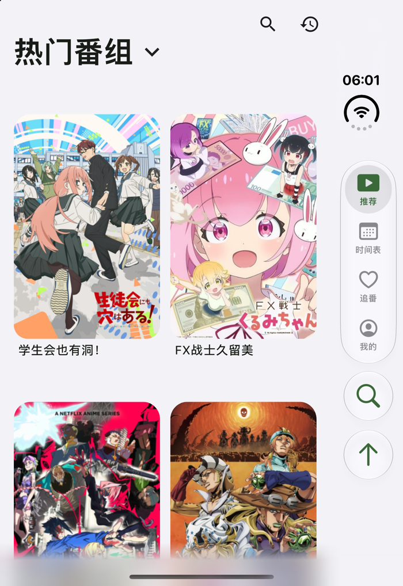
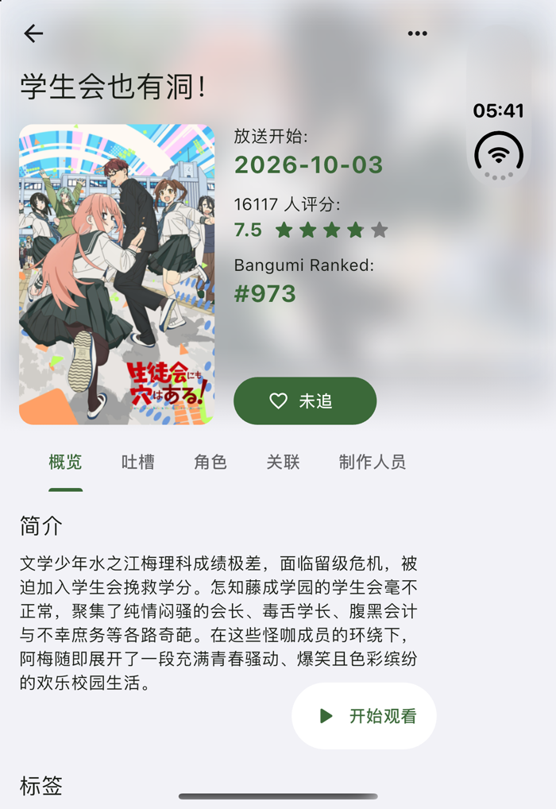
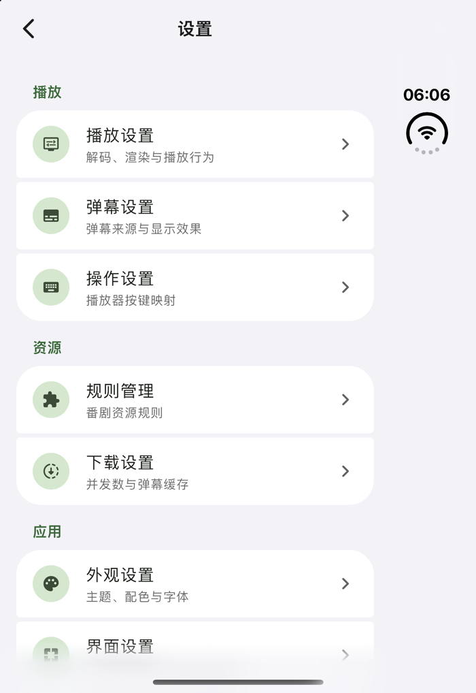
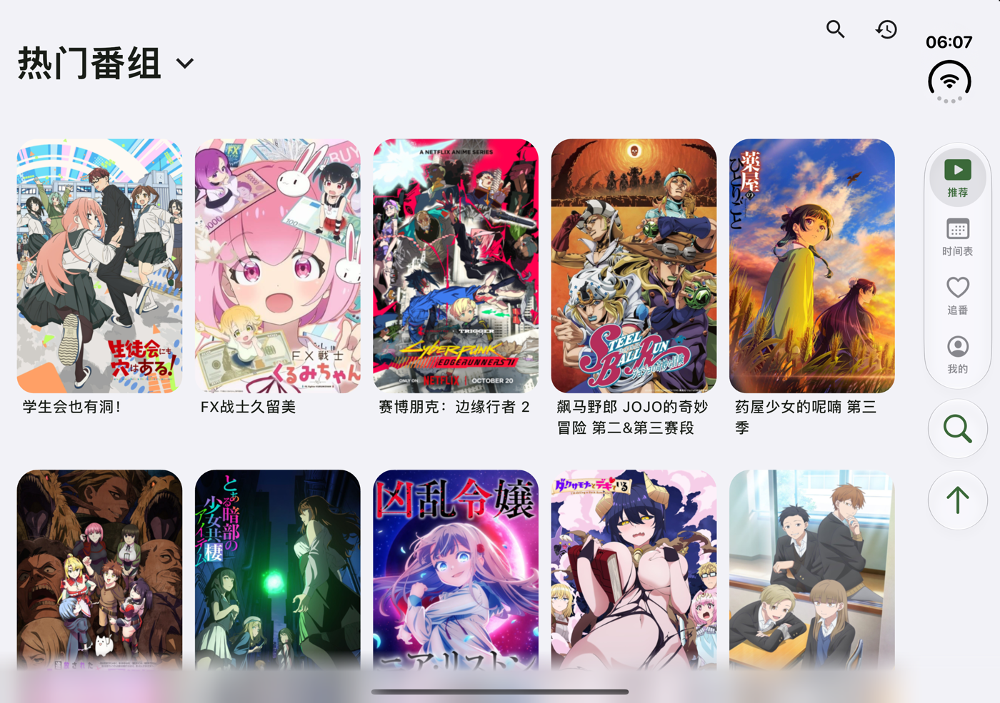
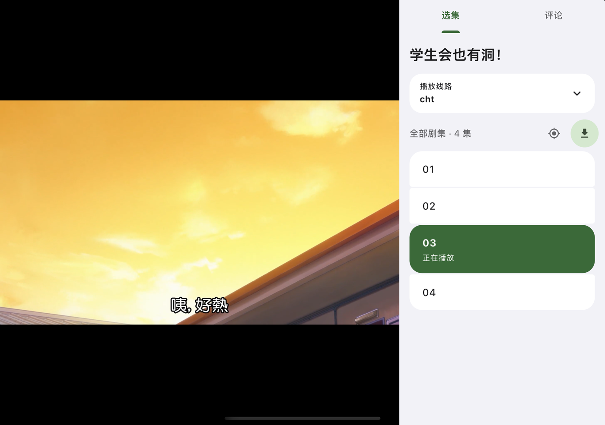
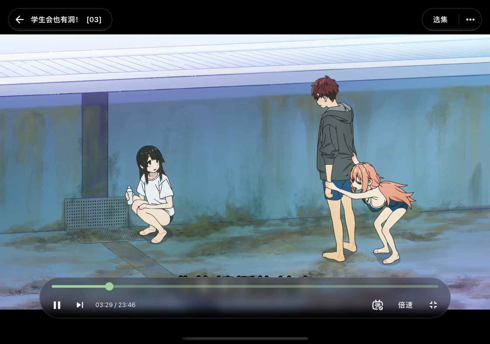

<h1>Kazumi Liquid Glass</h1>

为 iPhone 重新设计的番剧浏览与播放体验

Liquid Glass 导航 · iPhone Duo 自适应布局 · 悬浮玻璃播放器

  <a href="https://github.com/MichaelXiao-GIS/Kazumi-LiquidGlass/releases">下载 iOS 测试版</a> ·
  <a href="docs/ios27-liquid-glass.md">适配与构建说明</a> ·
  <a href="https://github.com/Predidit/Kazumi">上游 Kazumi</a>

**本项目是基于 [Predidit/Kazumi](https://github.com/Predidit/Kazumi) 2.4.2 修改的非官方 iOS 适配版本，由本仓库独立维护。** 保留 Kazumi 的 Flutter 架构、自定义规则、番剧目录、追番与播放能力，重点改进 iOS 界面、折叠屏布局和播放交互。

## 改版特色

- **液态玻璃导航**：悬浮标签栏与独立搜索入口，支持滑动时跟手移动的水滴指示器；根据可用空间切换底栏与侧栏。
- **iPhone Duo 内外屏适配**：按窗口、相机遮挡和折叠分区调整布局，切换屏幕时保留页面与播放状态。
- **新版播放器**：左上返回与标题、右上选集与更多菜单、底部悬浮玻璃控制条。宽屏支持左侧视频、右侧选集与评论。
- **横屏全屏**：点击全屏主动进入横屏；外屏按相机位置局部避让控件，退出后恢复系统方向控制。
- **统一的页面细节**：圆角卡片、分组设置、底部渐变模糊，以及随滚动平滑收起的“开始观看”按钮。
- **系统偏好适配**：支持深浅色、文字缩放与相关辅助功能偏好；降低透明度、增强对比度或减少动态效果时提供对应回退。

同时保留上游的规则导入与编辑、搜索与时间表、追番与历史记录、弹幕、倍速、下载、同步及 Anime4K 超分辨率等功能。实际可用性取决于平台、设备与视频源。

## 界面预览

以下为本适配版在 iPhone Duo / iOS 27.1 模拟器中的实际运行画面，分别展示外屏、内屏和播放布局。截图中的海报与视频仅用于展示界面，版权归各自权利人所有。

<table>
  <tr>
    <th width="33%">外屏推荐与玻璃导航</th>
    <th width="33%">番剧详情</th>
    <th width="33%">分组设置</th>
  </tr>
  <tr>
    <td></td>
    <td></td>
    <td></td>
  </tr>
</table>

**展开内屏 · 自适应内容与侧栏**

<table>
  <tr>
    <th width="50%">视频与选集左右分栏</th>
    <th width="50%">横屏全屏与悬浮玻璃控件</th>
  </tr>
  <tr>
    <td></td>
    <td></td>
  </tr>
</table>

## 下载与安装

当前测试版：[**iOS 27.1 test.10**](https://github.com/MichaelXiao-GIS/Kazumi-LiquidGlass/releases/tag/v2.4.2-ios27.1-test.10) · [全部版本与更新说明](https://github.com/MichaelXiao-GIS/Kazumi-LiquidGlass/releases)

1. 下载 Release 附件中的 `Kazumi_iOS27_unsigned.ipa`。
2. 使用自己的 Apple 开发者签名或侧载工具重新签名后安装。**IPA 未签名，不能直接点击安装。**
3. 覆盖安装时保持原有签名身份与 Bundle ID；升级前建议备份规则与追番数据。

构建使用 **iOS 27.1 SDK**，最低运行版本为 **iOS 15**。原生 Liquid Glass 与 Duo 场景适配需要相应系统支持，较旧系统使用回退界面。各版本的构建信息和 SHA-256 校验值随 Release 提供。

本仓库目前发布 iOS 预发布测试包。其他平台的官方版本请访问 [上游 Kazumi Releases](https://github.com/Predidit/Kazumi/releases)。

## 使用与反馈

- 规则格式与原版兼容，可参考上游的 [规则仓库](https://github.com/Predidit/KazumiRules) 和 [规则开发文档](https://kazumi.app/docs/rules/develop-rules)。
- 本改版的界面、布局或播放问题请提交到 [本仓库 Issues](https://github.com/MichaelXiao-GIS/Kazumi-LiquidGlass/issues)，附上版本、设备、系统版本和复现步骤。
- 视频源可能失效或包含源站广告；搜索、解析和播放结果受所选规则与第三方服务影响。
- 适配细节、构建步骤、已检查范围与待验证事项见 [iOS / iPhone Duo 适配说明](docs/ios27-liquid-glass.md)。

## 项目来源与许可

本项目基于 **[Predidit/Kazumi](https://github.com/Predidit/Kazumi)** 修改，初始基线为 2.4.2（[`7cb58d7d`](https://github.com/Predidit/Kazumi/commit/7cb58d7d)）。原软件及其基础功能由上游作者和贡献者开发；本仓库的工作主要是 iOS 界面改造、iPhone Duo 布局适配与相关问题修复。

本仓库与上游项目独立维护，并非 Kazumi 官方发行版，也不代表上游作者对本改版的支持或背书。请将本分支特有的问题反馈到本仓库。

代码继续遵循 **[GNU GPL v3](LICENSE)**。保留上游版权与许可声明；第三方依赖、字体、图标及媒体资源分别遵循其各自许可。

### 图标与资源署名

- 本仓库首页与 iOS 应用使用仓库所有者提供的[新图标](assets/images/logo/logo_ios.png)，后续 iOS 构建沿用此图标。
- 其他平台保留的上游图标来自 [Yuquanaaa](https://www.pixiv.net/users/66219277) 的 [Pixiv 作品](https://www.pixiv.net/artworks/116666979)，版权归原作者所有。上游注明已取得使用许可，该许可不等同于向第三方授予自由使用权。
- 内嵌 MiSans 字体由 Xiaomi 提供，相关信息见 [MiSans 官方页面](https://hyperos.mi.com/font/zh/details/sc/)。
- 界面截图中的番剧资料、海报与视频画面不属于本项目的开源代码许可范围。

### 使用声明

本项目提供基于自定义规则的浏览与播放工具，不托管或提供番剧视频资源。使用者应遵守所在地法律法规及第三方服务条款，仅访问和使用自己有权使用的内容。

软件按现状提供，不保证对所有设备、规则或视频源的兼容性、稳定性及持续可用性；具体免责范围以 [LICENSE](LICENSE) 为准。本分支的修改与维护由本仓库负责，不应归责于上游作者。

### 数据与第三方服务

本次 iOS 适配未新增账号系统或遥测服务。番剧资料、弹幕、视频解析、更新和用户启用的同步功能会连接相应第三方服务；自定义规则也会访问其配置的网站。相关网络请求受对应服务的隐私政策和条款约束。

## 致谢

首先感谢 **[Predidit](https://github.com/Predidit)** 与 **[Kazumi 全体贡献者](https://github.com/Predidit/Kazumi/graphs/contributors)** 提供原软件与持续维护。

同时感谢本项目沿用的开源项目及服务：[Flutter](https://flutter.dev/)、[XpathSelector](https://github.com/simonkimi/xpath_selector)、[Bangumi](https://bangumi.tv/)、[弹弹play](https://www.dandanplay.com/)、[Anime4K](https://github.com/bloc97/Anime4K)、[Syncplay](https://github.com/Syncplay/syncplay)、[trace.moe](https://trace.moe)、[media-kit](https://github.com/media-kit/media-kit)、[avbuild](https://github.com/wang-bin/avbuild) 与 [Hive](https://github.com/isar/hive)。
